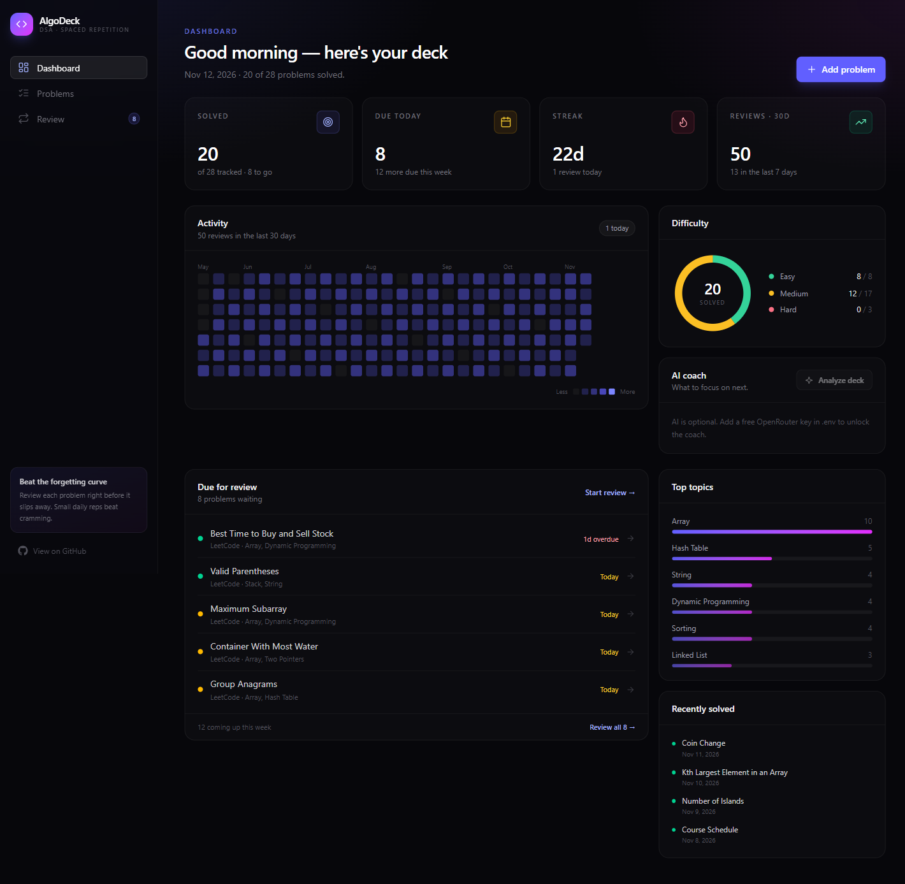
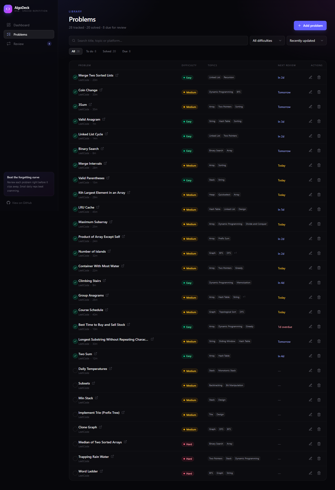
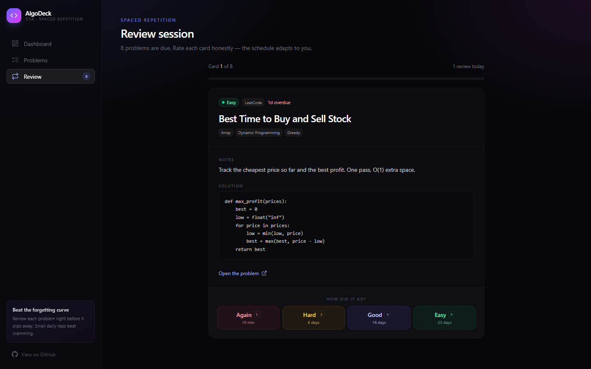
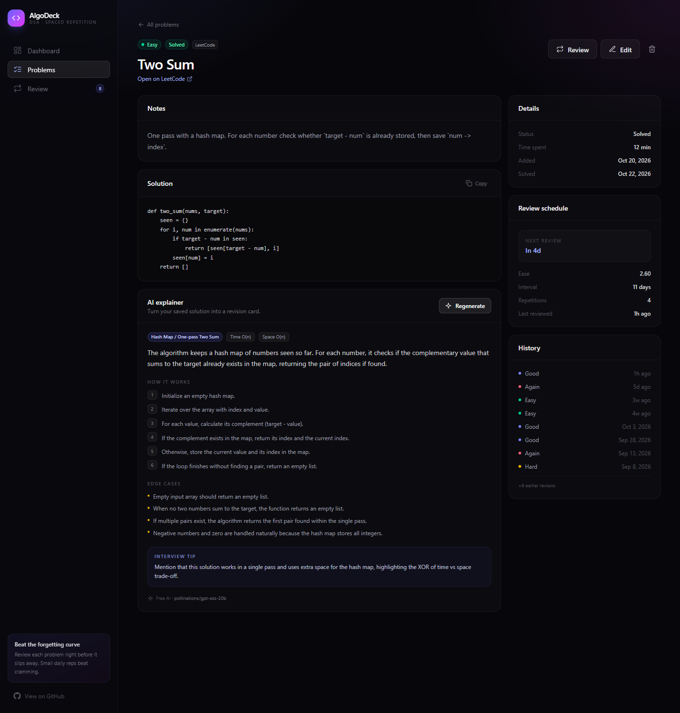

<div align="center">

# AlgoDeck

**Track the DSA problems you solve — and actually remember them.**

AlgoDeck is a full-stack practice tracker with a built-in spaced-repetition scheduler. Log what you solved, keep notes and solutions in one place, and let the app tell you exactly what to revisit before you forget it. AI hints, solution explainers and coaching work out of the box on free providers — no paid API key required.

[](https://nextjs.org/)
[](https://react.dev/)
[](https://www.typescriptlang.org/)
[](https://www.prisma.io/)
[](https://tailwindcss.com/)
[](https://www.sqlite.org/)
[](https://github.com/Cruzzop/algodeck/actions/workflows/ci.yml)
[](./LICENSE)

[Features](#features) · [Quick start](#quick-start) · [AI features](#ai-features-optional-free) · [Screenshots](#screenshots) · [How the scheduling works](#how-the-scheduling-works) · [API](#api-reference) · [Roadmap](#roadmap)

</div>

---

## Why AlgoDeck?

Most problem trackers stop at a checkbox. You solve a problem, mark it done, and three weeks later you cannot reproduce the approach.

AlgoDeck treats every solved problem like a flashcard. It schedules reviews using a simplified **SM-2 algorithm**, so each problem comes back right before it would slip out of memory — not every day, and not never.

- **Local-first.** Runs entirely on your machine with SQLite. No accounts, no subscriptions, no external services.
- **Honest review workflow.** Recall the approach first, then reveal your notes, then rate how it went.
- **Useful data, not vanity metrics.** Streaks, review heatmap, difficulty split, top topics and a live due queue.

## Features

- **Dashboard** — solved count, problems due today, review streak, 30-day review volume, a 26-week activity heatmap, difficulty donut, top topics and a due-today queue.
- **Problem library** — search by title/topic/platform, filter by status or difficulty, sort by recency, difficulty, due date or title.
- **Problem detail** — notes, saved solution, time spent, full review schedule (ease, interval, repetitions) and recent review history.
- **Review sessions** — keyboard-first reviewing (`space` to reveal, `1`–`4` to rate, `h` for a hint) with a live preview of the next interval for every rating.
- **Spaced repetition** — SM-2-inspired scheduling with four ratings: Again, Hard, Good, Easy. Again reschedules in 10 minutes; everything else grows the interval.
- **Built-in free AI** — progressive review hints, a solution explainer that turns saved code into a revision card, and a dashboard coach. Works with no key, and upgrades to OpenRouter free models when a key is added.
- **Quick actions** — add, edit, delete, and toggle solved/todo from the table without leaving the page.
- **Polished dark UI** — custom design system, inline SVG icons and charts, animated modals and toasts, responsive down to mobile. No UI-library dependency.
- **Typed end to end** — Prisma models, Zod request validation and shared TypeScript DTOs.

## Screenshots

### Dashboard



### Problem library



### Review session



### Problem detail



## Tech stack

| Layer      | Choice                                        | Why                                              |
| ---------- | --------------------------------------------- | ------------------------------------------------ |
| Framework  | **Next.js 15** (App Router, Server Components) | One codebase for UI and REST API                 |
| Language   | **TypeScript**                                 | Shared types between client and server           |
| UI         | **React 19** + **Tailwind CSS 4**              | Fast to build, easy to customise                 |
| Database   | **SQLite** via **Prisma 6**                    | Zero setup — the database is a single file       |
| Validation | **Zod**                                        | Parse and validate every API request             |
| AI         | **Pollinations + OpenRouter free models**      | Keyless AI out of the box; automatic fallback    |
| Icons      | Inline SVG components                          | No icon dependency, fully styleable              |
| Charts     | Hand-built SVG + CSS                          | No chart library, no bundle bloat                |

## Quick start

**Requirements:** Node.js 20+ (22 LTS recommended) and npm.

```bash
# 1. Install dependencies
npm install

# 2. Create your local env file
cp .env.example .env

# 3. Create the SQLite database and load demo data
npm run setup

# 4. Start the dev server
npm run dev
```

Open **http://localhost:3000**.

`npm run setup` generates the Prisma client, creates `prisma/dev.db`, and seeds 28 sample problems with six months of review history. To start with an empty deck instead, skip the seed:

```bash
npm install
cp .env.example .env
npx prisma db push
npm run dev
```

### Available scripts

| Script              | What it does                                             |
| ------------------- | -------------------------------------------------------- |
| `npm run dev`       | Start the dev server (also syncs the database schema)    |
| `npm run build`     | Generate the Prisma client and build for production      |
| `npm run start`     | Serve the production build                               |
| `npm run setup`     | Generate client, push schema, seed demo data             |
| `npm run db:seed`   | Re-seed demo data (wipes existing data)                  |
| `npm run db:reset`  | Force-reset the database, then seed                      |
| `npm run db:push`   | Push the Prisma schema without seeding                   |
| `npm run db:studio` | Open Prisma Studio to browse the database                |

## Deploy it free (always on)

The repo ships a production Docker image (`Dockerfile`) that runs anywhere Docker does. The fastest **free, always-on** option is Northflank's Sandbox tier — no credit card, and the app never sleeps or needs "waking up":

1. Create a free [Northflank](https://northflank.com) account → **Create project → Service → Build from Git**, connect this repo and pick **Dockerfile** as the build type.
2. Compute plan: `0.5 vCPU / 1 GB` is plenty (uses about $12 of the free $20/month Sandbox allowance).
3. **Volumes**: add a small volume (1–5 GB) mounted at `/app/prisma/data`. That is where the SQLite file lives, so your data survives restarts and redeploys.
4. **Ports**: add a public port `3000` (HTTP). Northflank issues a free HTTPS URL like `https://algodeck-xxxxx.code.run` and supports custom domains on the free plan.
5. Environment variables (all optional):
   - `SEED_DEMO_DATA="true"` — loads the 28-problem demo deck on the very first boot; it never overwrites existing data.
   - `OPENROUTER_API_KEY` — optional upgrade for the OpenRouter free-model chain. AI already works with no key.
6. Deploy. The container runs `prisma db push` on every boot, so schema changes ship together with the code, and pushes to `main` rebuild the service automatically.

> **Notes:** Northflank bills egress ($0.06/GB) against the free allowance, which is plenty for a portfolio. The Sandbox tier is meant for demos rather than production workloads. A good "forever server" alternative is Oracle Cloud's Always Free tier (2 ARM cores, 12 GB RAM) — the app runs unchanged on it with `npm run build && npm run start` behind Caddy.

## AI features (free, works out of the box)

AlgoDeck ships with three AI helpers that work **without any API key or signup**. The default provider is Pollinations' free GPT-OSS 20B endpoint, called server-side. If you want better quality and higher limits, add a free OpenRouter key — OpenRouter is then tried first, and the keyless provider stays as the final fallback.

```bash
# optional upgrade — get a free key at https://openrouter.ai/keys
OPENROUTER_API_KEY="sk-or-v1-..."
```

Restart the dev server after changing `.env`. No card or credits are needed. To disable the keyless path entirely, set `AI_KEYLESS_FALLBACK="false"`; AI then requires an OpenRouter key.

| Where | Feature | What it does |
| ----- | ------- | ------------ |
| Dashboard | **AI coach** | Reads your aggregate stats and due queue, then suggests one focus and a three-day plan. |
| Problem detail | **AI explainer** | Turns your saved solution into a revision card: core idea, pattern, complexity, steps, edge cases and an interview tip. |
| Review session | **Progressive hints** | Three levels of nudges, from a gentle pointer to a detailed outline — without revealing the final code. |

### Provider order and changing free models

Free model IDs on OpenRouter rotate often. AlgoDeck does not hard-code a single model:

1. If `OPENROUTER_API_KEY` is set, it reads `https://openrouter.ai/api/v1/models` at runtime and keeps only models whose prompt and completion prices are both `0` and that output text.
2. It ranks that live list with a small curated preference order and remembers the last model that worked, trying it first next time.
3. If a model is removed (`404`) or fails, it is marked unavailable for 10 minutes and the request retries on the next free model. Rate limits (`429`) and `5xx` responses fall through the same way.
4. The OpenRouter chain ends with its own `openrouter/free` router, which selects an available free model server-side.
5. If OpenRouter is unreachable or every attempt fails, the request falls back to the keyless provider.
6. Without an OpenRouter key, the keyless provider answers directly, so AI works on a fresh clone.

`GET /api/ai/status` shows the active provider, free-model count and the chain that would be tried. Set `OPENROUTER_MODEL` only if you want to pin one model ahead of the automatic chain.

> **Privacy:** prompts include the problem title, platform, difficulty and topics. The explainer also sends your notes and solution; the coach sends aggregate tracker stats. With no OpenRouter key, these requests go to Pollinations. With a key, OpenRouter and its free model providers are tried first. Don't use AI if your notes contain anything private.

> **Free-tier reality:** the keyless provider allows one text request per 30 seconds per IP. If you hit that limit, AlgoDeck shows a cooldown message with the wait time instead of hanging. OpenRouter's free models have their own rate limits, and the app tries several alternatives before giving up.

## How the scheduling works

Each solved problem stores three pieces of state: **ease**, **interval** and **repetition count**. When you rate a review, the scheduler updates them:

| Rating    | Effect                                                        | Typical next review |
| --------- | ------------------------------------------------------------- | ------------------- |
| **Again** | Reset repetitions, decrease ease, schedule in 10 minutes      | 10 minutes          |
| **Hard**  | Decrease ease, grow the interval slowly                       | 1–3 days            |
| **Good**  | Keep ease, grow the interval by the ease factor               | 3–14 days           |
| **Easy**  | Increase ease, grow the interval aggressively                 | 4–30+ days          |

Intervals are clamped between 1 and 365 days, and ease is clamped between 1.3 and 2.9 so a single bad day cannot permanently wreck a card. The logic lives in [`src/lib/srs.ts`](./src/lib/srs.ts) and is shared by the review UI (for interval previews) and the API (for the actual update).

> This is a deliberately small, readable implementation of SM-2. It is not a clinically tuned scheduler — it is a solid starting point you can extend.

## Project structure

```
.
├── prisma/
│   ├── schema.prisma          # Problem + ReviewLog models
│   └── seed.mjs               # Demo data (28 problems, ~250 reviews)
├── src/
│   ├── app/
│   │   ├── api/
│   │   │   ├── problems/      # GET, POST
│   │   │   │   ├── [id]/      # GET, PATCH, DELETE
│   │   │   │   │   └── review/# POST — record a review
│   │   │   ├── ai/                # POST hint, explain, coach + GET status
│   │   │   └── stats/         # GET — dashboard payload
│   │   ├── problems/          # Library + detail pages
│   │   ├── review/            # Review session page
│   │   ├── layout.tsx         # App shell + sidebar
│   │   ├── page.tsx           # Dashboard
│   │   ├── error.tsx          # Route error boundary
│   │   ├── loading.tsx        # Route skeleton
│   │   └── not-found.tsx      # 404 page
│   ├── components/
│   │   ├── ai/                # Coach, solution explainer, AI note
│   │   ├── dashboard/         # Heatmap, donut, topic bars, due list
│   │   ├── problems/          # Table, form modal, detail actions
│   │   ├── review/            # Keyboard-driven review session
│   │   └── ui/                # Button, input, modal, toast, empty state
│   └── lib/
│       ├── ai/                # Provider chain, OpenRouter, keyless, prompts
│       ├── db.ts              # Prisma singleton
│       ├── srs.ts             # Spaced-repetition scheduler
│       ├── queries.ts         # Dashboard aggregation
│       ├── validation.ts      # Zod schemas
│       ├── serialize.ts       # Prisma → JSON DTOs
│       └── format.ts          # Dates, due labels, intervals
└── docs/                      # README screenshots
```

## Data model

```prisma
model Problem {
  id         String    @id @default(cuid())
  title      String
  url        String?
  platform   String    @default("LeetCode")
  difficulty String    @default("MEDIUM") // EASY | MEDIUM | HARD
  status     String    @default("TODO")   // TODO | SOLVED
  topics     String    @default("")       // comma-separated
  notes      String?
  solution   String?
  timeSpentMin Int     @default(0)

  ease           Float    @default(2.5)
  intervalDays   Int      @default(0)
  repetitions    Int      @default(0)
  dueAt          DateTime?
  lastReviewedAt DateTime?
  solvedAt       DateTime?

  reviews ReviewLog[]
}

model ReviewLog {
  id         String   @id @default(cuid())
  problemId  String
  rating     Int      // 0 = Again, 1 = Hard, 2 = Good, 3 = Easy
  reviewedAt DateTime @default(now())
  problem    Problem  @relation(fields: [problemId], references: [id], onDelete: Cascade)
}
```

Topics are stored as a comma-separated string to keep the first version small. Normalising them into a `Topic` table is a good next step — see the roadmap.

## API reference

All endpoints return JSON. Errors use `{ "error": "message" }`, with `422` for validation failures and `404` for missing problems.

| Method   | Endpoint                     | Description                                   |
| -------- | ---------------------------- | --------------------------------------------- |
| `GET`    | `/api/problems`              | List problems. Supports `q`, `difficulty`, `status`, `sort`. |
| `POST`   | `/api/problems`              | Create a problem.                             |
| `GET`    | `/api/problems/:id`          | Fetch one problem with its review history.    |
| `PATCH`  | `/api/problems/:id`          | Update fields or toggle status.               |
| `DELETE` | `/api/problems/:id`          | Delete a problem and its review logs.         |
| `POST`   | `/api/problems/:id/review`   | Record a review `{ "rating": 0–3 }` and reschedule. |
| `GET`    | `/api/stats`                 | Dashboard aggregates (totals, streak, heatmap, due list). |
| `GET`    | `/api/ai/status`             | Active provider, free-model count and fallback chain. |
| `POST`   | `/api/ai/hint`               | Generate a hint `{ "problemId", "stage": 1–3 }`. |
| `POST`   | `/api/ai/explain`            | Explain a saved solution `{ "problemId" }`. |
| `POST`   | `/api/ai/coach`              | Analyse dashboard data and return a coaching report. |

AI endpoints return `429` when the keyless provider's 30-second cooldown is active, and `503` only if AI is explicitly disabled. Provider failures return `502`.

Example:

```bash
curl -X POST http://localhost:3000/api/problems \
  -H "Content-Type: application/json" \
  -d '{
    "title": "Trapping Rain Water",
    "url": "https://leetcode.com/problems/trapping-rain-water/",
    "platform": "LeetCode",
    "difficulty": "HARD",
    "status": "SOLVED",
    "topics": ["Two Pointers", "Stack"]
  }'
```

## Customising

- **Your GitHub link** — already set to [`github.com/Cruzzop`](https://github.com/Cruzzop) via `GITHUB_URL` in [`src/lib/constants.ts`](./src/lib/constants.ts). Change it if you fork the project.
- **Add platforms or topics** — edit `PLATFORMS` and `TOPIC_SUGGESTIONS` in the same file.
- **Change the schedule** — tune the multipliers and clamps in [`src/lib/srs.ts`](./src/lib/srs.ts).
- **AI models** — edit `PREFERRED_FREE_MODELS` in [`src/lib/ai/openrouter.ts`](./src/lib/ai/openrouter.ts) to change the OpenRouter preference order, set `OPENROUTER_MODEL` in `.env` to pin one model, or set `AI_KEYLESS_FALLBACK="false"` to disable the keyless provider.
- **Keyless model** — the Pollinations model ID is in [`src/lib/ai/keyless.ts`](./src/lib/ai/keyless.ts).
- **AI prompts** — hint levels, explainer JSON shape and coach instructions live in [`src/lib/ai/prompts.ts`](./src/lib/ai/prompts.ts).
- **Colours** — the accent gradient and surfaces are defined in [`src/app/globals.css`](./src/app/globals.css).

## Roadmap

This is a deliberately focused v1. Natural next steps:

- [ ] **Authentication and multi-user support** — NextAuth/Auth.js, per-user decks.
- [ ] **Normalised topics** — a `Topic` table plus many-to-many relations for accurate tag filtering.
- [ ] **Pagination and virtualised lists** — the library currently loads everything at once.
- [ ] **Automated tests** — Vitest for the scheduler, Playwright for the review flow.
- [ ] **Import from LeetCode** — paste a submission URL and prefill the problem.
- [ ] **Statistics page** — retention by topic, review forecast, time spent trends.
- [ ] **Streaming AI responses** — stream hints and explanations token by token.
- [ ] **Postgres + deployment** — swap the Prisma provider and ship to Vercel/Neon.

## Contributing

Issues and pull requests are welcome. If you are learning, treat this repository as a starting point: fork it, break it, rebuild it your way. A good first contribution is adding tests around `src/lib/srs.ts`.

## License

[MIT](./LICENSE) © 2026 AlgoDeck contributors

---

<div align="center">

Built as a portfolio project with Next.js, Prisma and a lot of LeetCode.

</div>
